# 鳶尾花 (Iris) 資料集分析報告

本報告逐一說明專案中每張輸出圖的 X 軸、Y 軸代表什麼，並解釋圖中觀察到的現象。
圖檔位於 [figures/](figures/)，由各程式執行後產生（原始輸出在 `outputs/`）。

## 1. 資料集簡介

Iris 資料集共 150 筆樣本，分為三個品種，每種 50 筆：

| 標籤 | 品種 |
|---|---|
| 0 | setosa |
| 1 | versicolor |
| 2 | virginica |

每筆樣本有 4 個特徵，單位皆為公分 (cm)：

| 特徵 | 中文 |
|---|---|
| sepal length | 花萼長度 |
| sepal width | 花萼寬度 |
| petal length | 花瓣長度 |
| petal width | 花瓣寬度 |

## 2. 重點結論

1. **花瓣特徵最有鑑別力。** 只看花瓣長度或寬度，三個品種幾乎就能分開；花萼特徵則讓 versicolor 與 virginica 大量重疊。
2. **setosa 很容易分出來，versicolor 與 virginica 有少量重疊。** 這個現象在原始特徵、LDA 投影、KNN 錯誤分類中都一致出現。
3. **KNN 以交叉驗證評估的準確率約 95–97.5%**，最佳 k = 17（97.5% ± 3.9%）。k = 1 過擬合，k > 22 欠擬合；但 k 的影響小於 1 個標準差。
4. **三種模型的錯誤全部發生在 versicolor 與 virginica 之間。** 混淆矩陣顯示 setosa 在 KNN、LDA、K-Means 中都 100% 正確；LDA 最準確（98%），K-Means 最差（89.3%），且 virginica 有 14 筆被分進 versicolor 群。
5. **Fisher LDA 的第一個判別軸就包含 99.12% 的類別間差異**，只用一維就能把三類分得很好。
6. **K-Means 的手肘法建議 k = 2–3，輪廓分析建議 k = 2**，與實際的 3 個品種不完全一致，原因是 versicolor 與 virginica 靠得太近；設成 8 群則會把同一品種切碎。
7. **只用花瓣特徵做 K-Means（k = 3）時，純度可達 96%**；只用花萼特徵時只有 82%。
8. **降到 1 維時 LDA 遠優於 PCA。** KNN 準確率為 97.5% 對 91.6%；只用 LDA 1 維甚至比原始 4 維（96.4%）還好。降到 2 維時兩者相當。
9. **決策邊界的形狀反映模型特性。** KNN k = 1 的邊界曲折（過擬合）、k = 17 平滑；LDA 與 K-Means 都是直線。只用花瓣兩個特徵時四種模型的準確率都約 95–96%，共同的錯誤全部位在 versicolor 與 virginica 的交界。

---

## 3. 資料探索

### 圖 3-1　訓練集散佈矩陣

程式：`01_data_exploration/02_train_test_split_scatter_matrix.py`

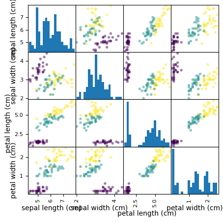

**座標軸**
- 這是 4 × 4 的子圖矩陣，順序為花萼長度、花萼寬度、花瓣長度、花瓣寬度。
- **非對角線**（第 i 列、第 j 欄）：X 軸 = 第 j 個特徵，Y 軸 = 第 i 個特徵 (cm)。每個點是一筆訓練資料。
- **對角線**：X 軸 = 該特徵的數值 (cm)，Y 軸 = 落在該區間的樣本數（直方圖，20 個 bin）。
- 顏色代表類別：紫 = setosa、青 = versicolor、黃 = virginica。

**觀察與解釋**
- 資料以 `test_size=0.33` 切分：100 筆訓練、50 筆測試，圖中只畫訓練集的 100 筆。
- 任何含花瓣長度或花瓣寬度的子圖，紫色點 (setosa) 都集中在左下角，與另外兩類完全分開。
- 花瓣長度 vs 花瓣寬度的子圖中，青色與黃色也大致分成兩團，只在交界處少量重疊。
- 花萼長度 vs 花萼寬度的子圖中，青色與黃色混在一起，難以區分。
- 花瓣長度、花瓣寬度的直方圖呈現明顯的兩個峰：左邊的峰是 setosa，右邊的峰是另外兩類。

### 圖 3-2　花萼 pairplot

程式：`01_data_exploration/03_seaborn_pairplot.py`（圖 1）

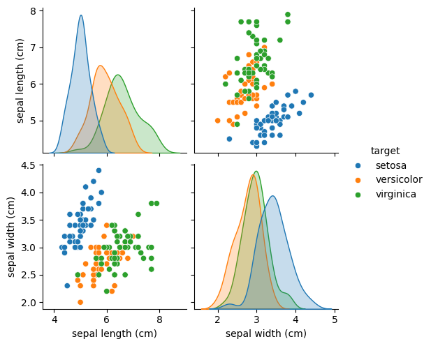

**座標軸**
- 2 × 2 子圖，特徵為花萼長度與花萼寬度。
- **非對角線**：X、Y 軸分別為兩個花萼特徵 (cm)，每個點是一筆資料。
- **對角線**：X 軸 = 該特徵的數值 (cm)，Y 軸 = 機率密度（KDE 平滑後的分佈曲線，圖上未標出）。
- 顏色代表品種：藍 = setosa、橘 = versicolor、綠 = virginica。

**觀察與解釋**
- setosa 的花萼較短（4.3–5.8 cm）而較寬（平均 3.4 cm，另兩類約 2.8–3.0 cm），在散佈圖中位於左上方，可單獨分出。
- versicolor 與 virginica 在散佈圖中大量重疊；兩者的花萼長度分佈曲線也重疊很多（versicolor 峰值約 5.9 cm，virginica 約 6.5 cm）。
- 花萼寬度的分佈曲線中，versicolor 與 virginica 幾乎疊在一起，setosa 只是略偏右（較寬），這是四個特徵中鑑別力最差的。

### 圖 3-3　花瓣 pairplot

程式：`01_data_exploration/03_seaborn_pairplot.py`（圖 2）

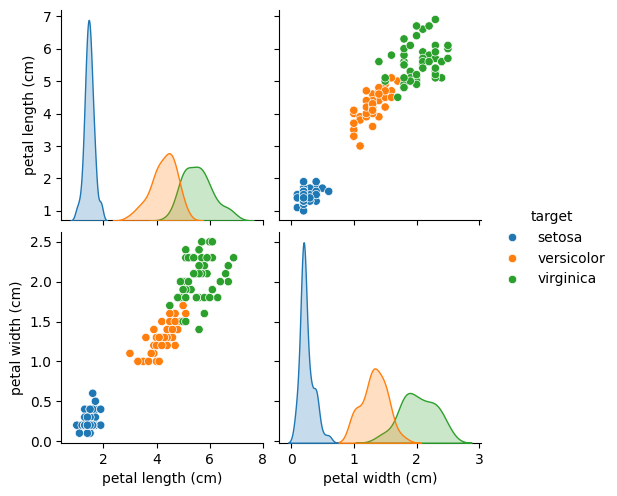

**座標軸**
- 與圖 3-2 相同，但特徵換成花瓣長度與花瓣寬度 (cm)。
- 對角線的 Y 軸為機率密度。

**觀察與解釋**
- setosa 的花瓣非常小（長約 1–1.9 cm、寬約 0.1–0.6 cm），與其他兩類之間有很大的空白，分佈曲線完全不重疊。
- versicolor 與 virginica 沿著一條斜線排列：花瓣越長就越寬，兩個特徵高度正相關。
- 兩類只在花瓣長度 4.5–5.1 cm、花瓣寬度 1.4–1.8 cm 的範圍內有重疊，落在這個範圍的點不多。
- 結論：**花瓣特徵比花萼特徵更適合用來分類。**

### 圖 3-4　花萼散佈圖

程式：`01_data_exploration/03_seaborn_pairplot.py`（圖 3）

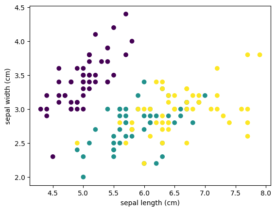

**座標軸**
- X 軸 = 花萼長度 (cm)，Y 軸 = 花萼寬度 (cm)。
- 顏色依數字標籤：紫 = 0 (setosa)、青 = 1 (versicolor)、黃 = 2 (virginica)。圖中沒有圖例。

**觀察與解釋**
- 資料內容與圖 3-2 左下角那格相同，只是改用 matplotlib 畫、換了配色。
- 同樣可以看到：setosa 在左上方獨立成一團，versicolor 與 virginica 在右下方混在一起。

---

## 4. KNN 分類

| 程式 | 切分方式 | 結果 |
|---|---|---|
| `02_knn_classification/01_knn_manual_shuffle_split.py` | 手動亂數打亂（固定種子 0），100 筆訓練 / 50 筆測試，k = 5 | 50 筆中錯 2 筆（96%），兩筆都是 versicolor 被誤判為 virginica |
| `02_knn_classification/02_knn_train_test_split.py` | `train_test_split`，`random_state=0`，k = 5 | 準確率 **0.98**；50 筆中錯 1 筆，是 versicolor 被誤判為 virginica |

**解釋**
- 錯誤都發生在 versicolor 與 virginica 之間，與第 3 節觀察到的重疊區域一致；setosa 從未被分錯。
- KNN 依據距離最近的 5 筆訓練資料投票，交界處的樣本鄰居同時包含兩類，因此最容易出錯。
- 只切一次資料的準確率很受切法影響：測試集只有 50 筆，多錯 1 筆準確率就差 2%。下一節改用交叉驗證取得穩定的估計。

### 圖 4-1　KNN 交叉驗證：準確率 vs k

程式：`02_knn_classification/03_knn_cross_validation.py`

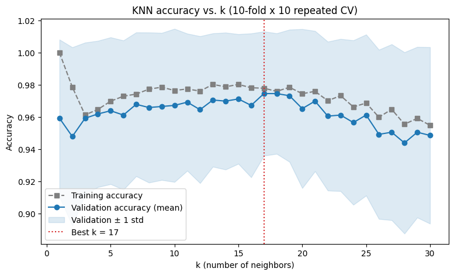

**方法**
- 使用**重複分層 10-fold 交叉驗證**（`RepeatedStratifiedKFold`，10 折 × 重複 10 次）。
  - 每一次把 150 筆資料分成 10 份，輪流用 9 份訓練、1 份（15 筆）驗證。
  - 「分層」讓每一份中三個品種各佔 1/3。
  - 整個流程以不同的隨機切法重複 10 次，所以每個 k 共有 100 個驗證準確率。
- 與只切一次相比，這樣得到的準確率不受單次切法的運氣影響，還能估計出標準差。

**座標軸**
- X 軸 = k，也就是 KNN 投票時參考的鄰居數（1–30）。
- Y 軸 = 準確率 (Accuracy)：
  - **灰色虛線**：訓練準確率，用訓練資料本身評估。
  - **藍色實線**：驗證準確率，100 次的平均值。
  - **淺藍色帶**：驗證準確率 ± 1 個標準差。
  - **紅色點線**：驗證準確率最高的 k。

**觀察與解釋**

| k | 1 | 5 | 17（最佳） | 30 |
|---|---|---|---|---|
| 訓練準確率 | 100% | 97.0% | 97.8% | 95.5% |
| 驗證準確率 | 95.9% ± 4.9% | 96.4% ± 4.6% | **97.5% ± 3.9%** | 94.9% ± 5.5% |

- **k = 1 過擬合 (overfitting)。** 每個訓練點的最近鄰居就是自己，所以訓練準確率必定是 100%；但驗證準確率只有 95.9%，兩者差距最大，表示模型記住了訓練資料，泛化能力較差。
- **k = 13–19 表現最好。** 驗證準確率在這一段最高，最佳為 k = 17（97.5%），訓練與驗證準確率也最接近。
- **k 太大會欠擬合 (underfitting)。** k > 22 之後，訓練與驗證準確率**一起**下降：參考的鄰居太多，交界處的樣本會被遠處另一類的點「投票」拉走，模型變得太粗糙。
- **不同 k 之間的差異其實不大。** 整條曲線都落在 94–97.5% 之間，差距小於 1 個標準差（約 4–5%），所以 k = 5 和 k = 17 在統計上沒有顯著差別。Iris 是很容易分類的資料集，k 的選擇影響有限。
- **色帶超過 100% 不代表準確率超過 100%。** 每一折只有 15 筆，錯 1 筆準確率就掉 6.7%，所以各折的準確率差異很大，平均值 + 1 標準差才會超出 1.0。這也說明單次切分的結果（第 4 節開頭的表）不可靠。

---

## 5. K-Means 分群

### K-Means 運作原理

1. 決定要把樣本分成幾群，也就是 k。
2. 隨機選出 k 個中心點。
3. 計算每個樣本到每個中心點的距離，把樣本分到最近的中心點那一群。
4. 以每一群所有樣本的平均座標作為新的中心點。
5. 重複步驟 3、4，直到中心點不再變動為止。

從原理可以看出兩個特性，後面各圖都會看到：
- **k 必須事先指定。** K-Means 一定會切出 k 群，不會判斷資料是否真的有 k 群，因此需要手肘法、輪廓分析等方法輔助選擇 k。
- **結果受初始中心點影響。** 不同的隨機初始值可能得到不同結果，所以 sklearn 預設會用不同初始值跑多次 (`n_init`)，取 SSE 最小的一次。

### 圖 5-1　K-Means 示範（隨機資料）

程式：`03_kmeans_clustering/01_kmeans_blobs_demo.py`

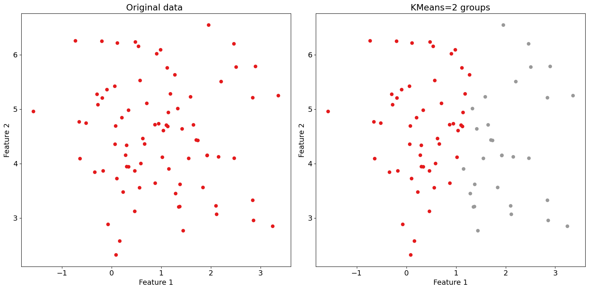

**座標軸**
- 左右兩張子圖的 X 軸 = Feature 1，Y 軸 = Feature 2，是 `make_blobs` 產生的兩個特徵。這是人工資料，沒有單位與實際意義。
- 左圖顏色 = 產生資料時的原始標籤；右圖顏色 = K-Means 分出的群。

**觀察與解釋**
- 資料以 `centers=1` 產生，80 個點其實都來自同一群，所以左圖全部是同一個顏色。
- 右圖中，K-Means 仍然依照 `n_clusters=2` 把資料切成兩群，大約以 Feature 1 ≈ 1.3 為界分成左右兩半。
- 這說明 **K-Means 一定會切出 k 群，不會判斷資料是否真的有 k 群**，因此 k 必須另外決定，例如用第 5-3 節的手肘法。
- 程式固定 `random_state=0`，每次執行的資料點與切法都相同。若拿掉種子，每次產生的資料不同，切開的方向也會跟著改變，但一定還是切成 2 群。

### 圖 5-2　Iris K-Means 分群（k = 8）與原始標籤對照

程式：`03_kmeans_clustering/02_kmeans_iris.py`

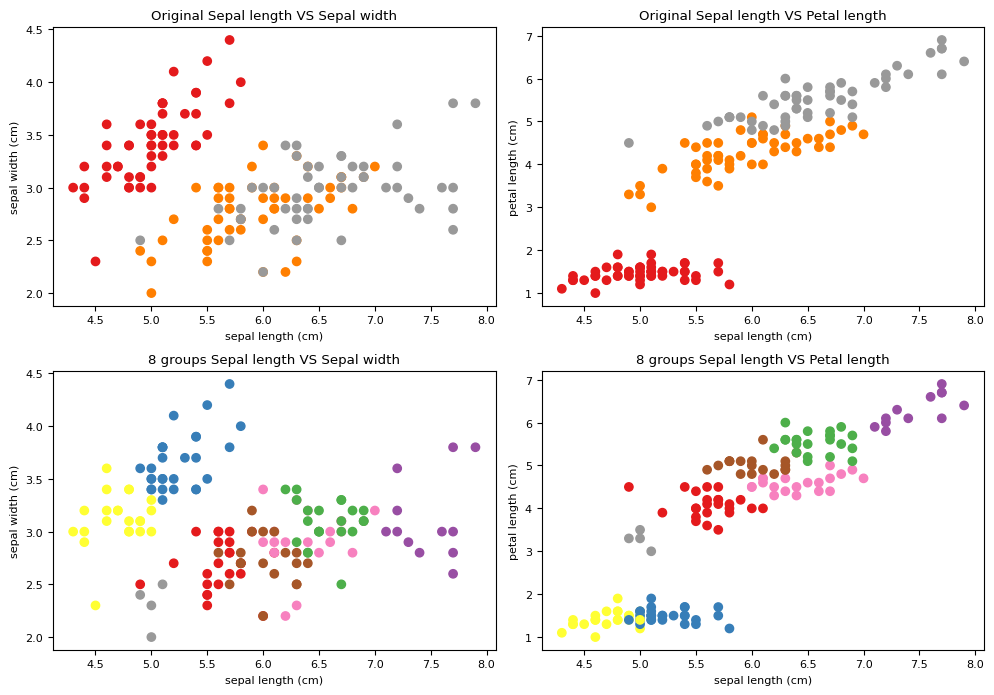

**座標軸**

| 子圖 | X 軸 | Y 軸 | 顏色 |
|---|---|---|---|
| 左上 | 花萼長度 (cm) | 花萼寬度 (cm) | 原始品種 |
| 右上 | 花萼長度 (cm) | 花瓣長度 (cm) | 原始品種 |
| 左下 | 花萼長度 (cm) | 花萼寬度 (cm) | K-Means 群編號 |
| 右下 | 花萼長度 (cm) | 花瓣長度 (cm) | K-Means 群編號 |

上排配色：紅 = setosa、橘 = versicolor、灰 = virginica。下排 8 種顏色只是群編號，與上排顏色沒有對應關係。

**觀察與解釋**
- 程式設定 `n1 = 8`，比實際的 3 個品種多，因此每個品種都被切成好幾群：
  - **setosa**：依花萼長度切成 2 群，黃色 22 筆（4.3–5.0 cm）、藍色 28 筆。
  - **versicolor**：主要分成 2 群（23、20 筆），另有 4 筆花萼特別短的樣本自成灰色小群。
  - **virginica**：切成 3 群（22、12、15 筆），其中花萼最長的 12 筆是紫色那群。
- 8 群中只有 2 群混了不同品種，合計 4 筆，所以每一群幾乎都只含單一品種。k 太大時，K-Means 會把同一品種內部再細分，而不是把不同品種混在一起。
- K-Means 用 4 個特徵計算距離，但圖只畫出其中 2 個，所以有些顏色在圖上看起來交錯，在 4 維空間中其實是分開的。
- 右欄（花萼長度 vs 花瓣長度）比左欄更容易看出群的結構，因為花瓣長度的鑑別力較高。
- 程式固定 `random_state=0` 並用 `n_init=10` 跑 10 次取最佳結果，每次執行結果相同。

### 圖 5-3　手肘法（4 個特徵）

程式：`03_kmeans_clustering/03_elbow_sse_iris.py`

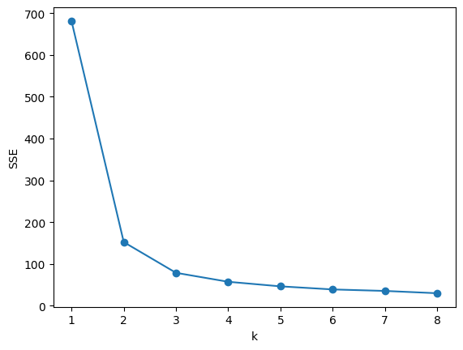

**座標軸**
- X 軸 = 分群數 k（1–8）。
- Y 軸 = SSE（Sum of Squared Errors，群內誤差平方和）：每個點到所屬群中心的距離平方總和。數值越小，代表群內越緊密。

**觀察與解釋**

| k | 1 | 2 | 3 | 4 | 5 | 6 | 7 | 8 |
|---|---|---|---|---|---|---|---|---|
| SSE | 681.4 | 152.3 | 78.9 | 57.2 | 46.4 | 39.0 | 34.4 | 30.1 |

- k 從 1 到 2 時 SSE 大幅下降 78%，從 2 到 3 再降一半；k ≥ 3 之後每次只降一點點，曲線趨於平緩。
- 曲線轉折的「手肘」在 **k = 2–3**，表示 2–3 群就能抓住資料的主要結構。
- k = 2 也是合理的選擇，因為 versicolor 與 virginica 本來就靠得很近，K-Means 容易把它們視為同一群；k = 3 則對應實際的 3 個品種。
- SSE 隨 k 增加必定下降（k = 150 時為 0），所以不能只挑 SSE 最小的 k，要看下降開始變緩的位置。

### 圖 5-4　手肘法（只用花萼長度）

程式：`03_kmeans_clustering/04_elbow_sse_from_csv.py`

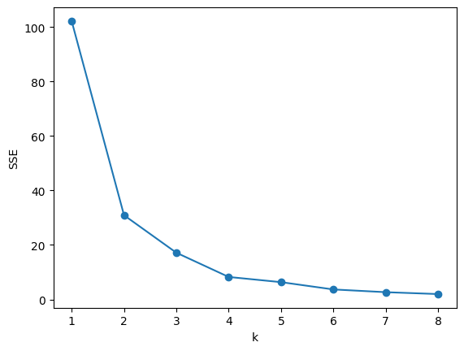

**座標軸**
- X 軸 = 分群數 k（1–8）。
- Y 軸 = SSE，只依據 `data/iris.csv` 中的 sepal length (cm) 一個特徵計算。

**觀察與解釋**
- SSE 約為 102 → 31 → 16 → 8 → …，手肘同樣落在 k = 2–3，但轉折沒有圖 5-3 明顯。
- 只有一個特徵時，分群等於把數線切成幾段區間；花萼長度在三個品種間重疊很多，分出的群與實際品種的對應較差。
- 整體 SSE 比圖 5-3 小很多，是因為只有一個維度的距離，並不代表分群效果比較好。兩張圖的 SSE 不能直接比較。

### 圖 5-5　不同 k 的分群比較：花萼特徵 vs 花瓣特徵

程式：`03_kmeans_clustering/05_kmeans_compare_k.py`

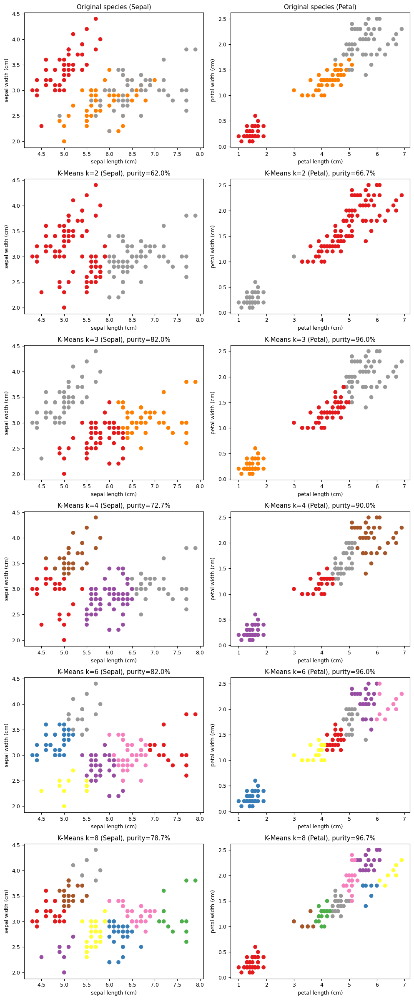

**座標軸**
- **左欄**：X 軸 = 花萼長度 (cm)，Y 軸 = 花萼寬度 (cm)。K-Means **只用這兩個花萼特徵**分群。
- **右欄**：X 軸 = 花瓣長度 (cm)，Y 軸 = 花瓣寬度 (cm)。K-Means **只用這兩個花瓣特徵**分群。
- 第一列的顏色是原始品種：紅 = setosa、橘 = versicolor、灰 = virginica。
- 其餘各列依序是 k = 2、3、4、6、8，顏色只代表群編號，與第一列的顏色沒有對應關係。
- 每張子圖標題中的 purity（純度）是這樣算的：把每一群對應到群內數量最多的品種，再計算符合的樣本比例。純度越高，表示分群與實際品種越一致。
- 程式固定 `random_state=0`，每次執行結果相同。

**各 k 的純度**

| k | 2 | 3 | 4 | 6 | 8 |
|---|---|---|---|---|---|
| 只用花萼 | 62.0% | 82.0% | 72.7% | 82.0% | 78.7% |
| 只用花瓣 | 66.7% | **96.0%** | 90.0% | 96.0% | 96.7% |

**觀察與解釋**
- **花萼分群的邊界模糊。** 第一列左圖中，versicolor 與 virginica 在花萼特徵上大量重疊。K-Means 只能沿著距離把重疊區硬切開，所以 k = 3 時有 27 筆被分到另一個品種為主的群，純度只有 82%。k 增加後，重疊區被切得更零碎，純度也上下波動。
- **花瓣分群乾淨俐落。** 花瓣特徵本身就分得很開，k = 3 時只有 6 筆分錯：4 筆 virginica 被分進 versicolor 群，2 筆 versicolor 被分進 virginica 群。純度 96%，錯誤都集中在兩類的交界處。
- **分群數增加時，被切開的多半是大群。** 右欄 k = 3 之後，setosa 在每個 k 都完整保持為同一群（50 筆），新增的群都是從 versicolor 與 virginica 這一大團中切出來。左欄則不同：setosa 從 k = 4 開始就被切成 2–4 群，因為花萼特徵沒有明顯的群間空隙。
- **k = 2 時兩種特徵的切法不同。** 花瓣把 setosa（加上 1 筆 versicolor）與其他兩類分開，純度 66.7%，等於「只分出 setosa」；花萼則大致按長度切成兩半，setosa 和 33 筆花萼較短的 versicolor/virginica 被分在同一群，純度只有 62%。

### 圖 5-6　輪廓分析（4 個特徵）

程式：`03_kmeans_clustering/06_silhouette_iris.py`

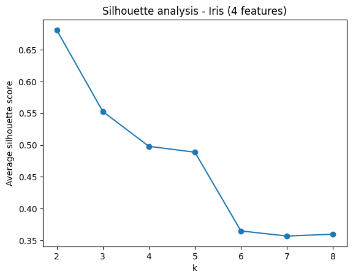

**座標軸**
- X 軸 = 分群數 k（2–8）。輪廓係數至少需要 2 群才能計算，所以從 2 開始。
- Y 軸 = 平均輪廓係數 (Silhouette score)，範圍為 −1 ~ 1。對每個樣本計算：

  s = (b − a) / max(a, b)

  - a = 該樣本到同群其他點的平均距離。
  - b = 該樣本到最近的另一群的平均距離。

  數值越接近 1，代表群內越緊密、與其他群分得越開；接近 0 代表落在兩群交界。

**觀察與解釋**

| k | 2 | 3 | 4 | 5 | 6 | 7 | 8 |
|---|---|---|---|---|---|---|---|
| 輪廓係數 | **0.681** | 0.553 | 0.498 | 0.489 | 0.365 | 0.357 | 0.360 |

- 輪廓係數在 **k = 2 最高**，之後大致隨 k 增加而下降，所以輪廓分析選出的最佳 k = 2。
- 這和圖 5-3 手肘法的 k = 2–3 一致，但與實際的 3 個品種不同。原因是 versicolor 與 virginica 在 4 維空間中靠得太近：分成 2 群時，「setosa」與「其他」之間的分離度最大，輪廓係數自然最高。
- 這說明手肘法與輪廓分析衡量的是**資料在幾何上最自然的分法**，不一定等於標籤定義的類別數。實務上沒有標籤時，k = 2 是合理的答案；有標籤時才能知道 3 是實際品種數。

### K-Means 綜合討論

整理圖 5-1 到 5-6 的結果：

- **初始中心點會影響結果。** 如果不固定亂數種子，每次執行時邊界與極值附近的點常被分到不同群。本專案所有 K-Means 程式都固定 `random_state=0`，並用 `n_init=10` 以不同初始中心跑 10 次、取 SSE 最小的結果，因此結果穩定且可重現。
- **特徵的鑑別力決定分群品質。** 同樣 k = 3，花瓣特徵純度 96%，花萼特徵 82%，使用全部 4 個特徵則為 89.3%。加入鑑別力差的花萼特徵，反而會拉低純度。
- **極值的影響比預期小。** K-Means 以平均值作為中心，理論上容易被極值拉偏；但 Iris 的極值不多，k = 3 時花瓣分群的 6 個錯誤都在 versicolor 與 virginica 的交界，不是遠離群體的極值造成的。
- **最佳 k 要結合多種方法判斷。** 手肘法（k = 2–3）與輪廓分析（k = 2）都沒有直接得到 3。若事先知道類別數，應以實際需求為準；若不知道，k = 2 是資料本身最明顯的結構。

---

## 6. Fisher 線性判別分析 (LDA)

LDA 會找出一組投影方向（判別軸），讓**不同類別的平均值盡量拉開，同一類別內的資料盡量集中**。
Iris 有 3 類，所以最多只能得到 3 − 1 = 2 個判別軸：

| 判別軸 | 包含的類別間差異 |
|---|---|
| Fisher Feature One (LD1) | 99.12% |
| Fisher Feature Two (LD2) | 0.88% |

判別軸是 4 個原始特徵的線性組合，投影後的數值**沒有物理單位**，只代表樣本在該方向上的位置。

### 圖 6-1　LDA 一維投影直方圖

程式：`04_fisher_lda/01_lda_1d_histogram.py`

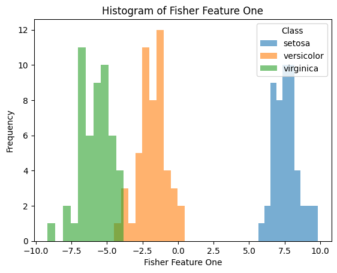

**座標軸**
- X 軸 = Fisher Feature One：樣本投影到第一個判別軸後的數值（無單位）。
- Y 軸 = Frequency：落在該區間的樣本數。每個品種各自分 10 個 bin。

**觀察與解釋**
- 三個品種沿 X 軸由左到右依序為 virginica（約 −9.2 ~ −3.8）、versicolor（約 −4.5 ~ 0.5）、setosa（約 5.7 ~ 9.9）。
- setosa 與其他兩類相距 5 個單位以上，完全分開。
- versicolor 與 virginica 只在 −4.5 ~ −3.8 之間有一小段重疊，對應到前面觀察到的交界樣本。
- 只用一個 LDA 特徵，就能達到接近 4 個原始特徵的分類效果。

### 圖 6-2　LDA 二維散佈圖（基本版）

程式：`04_fisher_lda/02_lda_2d_scatter_basic.py`

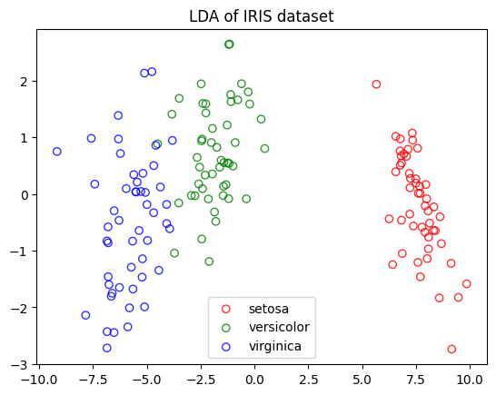

**座標軸**
- X 軸 = Fisher Feature One (LD1)，Y 軸 = Fisher Feature Two (LD2)，皆無單位。這張圖沒有標出軸名。
- 空心點顏色：紅 = setosa、綠 = versicolor、藍 = virginica。

**觀察與解釋**
- 三類主要沿 **X 軸** 分開：setosa 在右側，versicolor 在中間，virginica 在左側。
- Y 軸方向上三類的範圍都差不多（約 −3 ~ 2.5），對分類幫助很小，符合 LD2 只佔 0.88% 的結果。
- versicolor 與 virginica 在 X ≈ −4 附近相鄰，有少數點靠得很近。
- 以 LDA 本身當分類器，訓練集準確率為 98%（150 筆中錯 3 筆）。

### 圖 6-3　LDA 二維散佈圖（加上軸標籤）

程式：`04_fisher_lda/03_lda_2d_scatter_labeled.py`

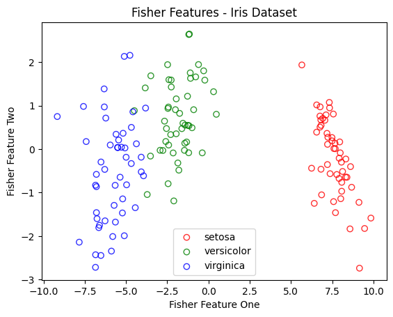

**座標軸**
- 與圖 6-2 相同：X 軸 = Fisher Feature One，Y 軸 = Fisher Feature Two，這次在圖上標出了軸名。

**觀察與解釋**
- 資料點與圖 6-2 完全相同，只差在標題與軸標籤，觀察結果也相同。

### 圖 6-4　LDA 二維散佈圖（實心點）

程式：`04_fisher_lda/04_lda_2d_scatter_filled.py`

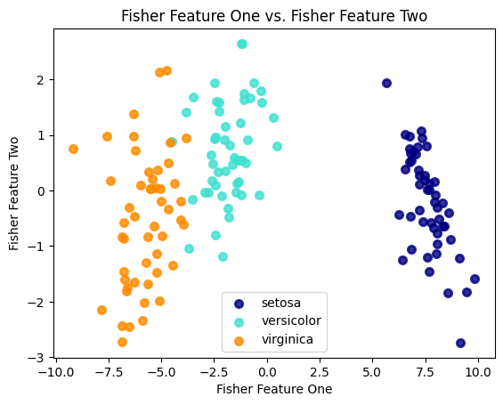

**座標軸**
- 與圖 6-3 相同。
- 改用實心點，配色為：深藍 = setosa、青綠 = versicolor、橘 = virginica。

**觀察與解釋**
- 資料與圖 6-2、6-3 相同。實心點讓各類的密集區更明顯，但重疊的點會互相遮住。
- 在 versicolor 與 virginica 的交界，空心點（圖 6-3）比較容易看出點是否重疊。

### 圖 6-5　LDA 二維散佈圖加上共變異數橢圓

程式：`04_fisher_lda/05_lda_2d_scatter_ellipse.py`

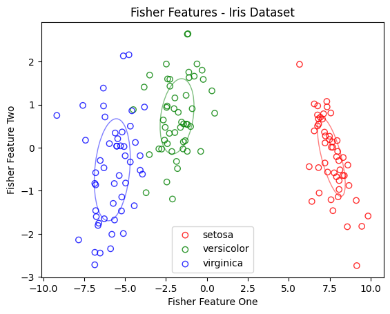

**座標軸**
- 與圖 6-3 相同：X 軸 = Fisher Feature One，Y 軸 = Fisher Feature Two。

**橢圓的意義**
- 每個品種畫一個橢圓：
  - 中心 = 該類別在 LD1、LD2 上的平均值。
  - 方向 = 該類別共變異數矩陣的特徵向量。
  - 軸長 = 2√(特徵值)，大約涵蓋平均值 ±1 個標準差的範圍。

**觀察與解釋**
- 三個橢圓互不重疊，表示在 1 個標準差的範圍內三類都能分開。
- versicolor 與 virginica 的橢圓都是**直立細長**的：同一類在 LD1 方向很集中，在 LD2 方向較分散。這正是 LDA 的設計目標，也就是在判別軸上縮小類內差異。
- setosa 的橢圓略微傾斜，表示 setosa 內部的 LD1 與 LD2 有些相關。
- 三個橢圓的大小與形狀大致相近，與 LDA「各類別共變異數相同」的假設相符；virginica 的橢圓略大，表示其類內分散程度稍高。

### 圖 6-6　手動計算的 Fisher feature 直方圖

程式：`04_fisher_lda/06_fisher_manual_histogram.py`

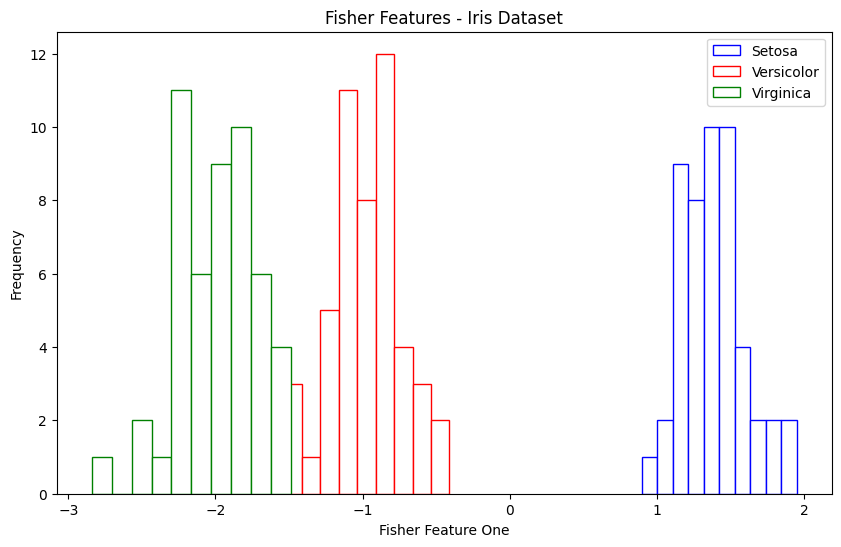

**座標軸**
- X 軸 = Fisher Feature One：用 numpy 手動計算 inv(Sw) · Sb 的最大特徵向量，把資料投影上去後再取負值（無單位）。
- Y 軸 = Frequency：落在該區間的樣本數。
- 空心長條顏色：藍 = Setosa、紅 = Versicolor、綠 = Virginica。

**觀察與解釋**
- 三類的排列順序與分離情形和圖 6-1（sklearn 結果）一致：virginica 在左、versicolor 在中、setosa 在右；versicolor 與 virginica 只在 −1.5 附近少量重疊。
- X 軸範圍（約 −2.8 ~ 2）比圖 6-1（約 −9 ~ 10）小，原因是兩者的縮放方式不同：
  - 手動版的特徵向量長度為 1。
  - sklearn 會再縮放，讓類內變異數為 1。
  
  兩者方向相同，只差一個比例常數，**不影響分類結果**。
- 程式中的「取負值」只是把方向翻過來，讓 setosa 落在右側，與 sklearn 的圖方向一致。

---

## 7. 模型評估：混淆矩陣

### 圖 7-1　KNN、LDA、K-Means 的混淆矩陣

程式：`05_model_evaluation/01_confusion_matrices.py`

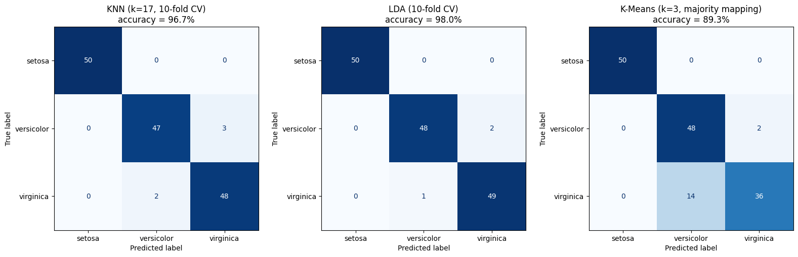

**方法**
- **KNN（k = 17）與 LDA** 使用 10-fold 交叉驗證的 `cross_val_predict`：每筆樣本都由**沒看過它**的模型預測，所以 150 筆都是公平的測試結果。
- **K-Means（k = 3）** 不使用標籤，所以對全部資料分群後，再把每一群對應到群內最多的品種，當作它的「預測」。

**座標軸**
- 每張圖是 3 × 3 的表格：
  - **Y 軸（列，True label）** = 實際品種。
  - **X 軸（欄，Predicted label）** = 模型預測的品種。
- 格子中的數字 = 「實際是該列品種、被預測為該欄品種」的樣本數，顏色越深代表數量越多。
- **對角線**是預測正確的筆數，對角線以外都是錯誤。每一列加總都是 50。

**各模型的錯誤分佈**

| 模型 | 準確率 | versicolor → virginica | virginica → versicolor | setosa 錯誤 |
|---|---|---|---|---|
| KNN (k = 17) | 96.7% | 3 | 2 | 0 |
| LDA | **98.0%** | 2 | 1 | 0 |
| K-Means (k = 3) | 89.3% | 2 | **14** | 0 |

**各類別的 precision / recall**

| 模型 | 品種 | Precision | Recall |
|---|---|---|---|
| KNN | versicolor | 95.9% | 94.0% |
| KNN | virginica | 94.1% | 96.0% |
| LDA | versicolor | 98.0% | 96.0% |
| LDA | virginica | 96.1% | 98.0% |
| K-Means | versicolor | 77.4% | 96.0% |
| K-Means | virginica | 94.7% | **72.0%** |

三個模型的 setosa precision 與 recall 都是 100%，所以表中省略。

- **Precision**（精確率）：被預測為該品種的樣本中，真的是該品種的比例。
- **Recall**（召回率）：實際是該品種的樣本中，被正確找出來的比例。

**觀察與解釋**
- **證實了前面各節的推論：所有錯誤都在 versicolor 與 virginica 之間，setosa 在三個模型中都 100% 正確。** 這與第 3 節的資料探索（兩類在特徵空間中相鄰）、第 6 節的 LDA 投影（兩類在 Fisher Feature One 上有少量重疊）一致。
- **LDA 最準確（98%）。** Iris 的三類大致是形狀相近的橢圓分佈，正好符合 LDA「各類共變異數相同、邊界為直線」的假設（見圖 6-5）。
- **KNN 次之（96.7%）。** 錯誤數與 LDA 相差 2 筆，在 150 筆的資料量下差異不大。圖 4-1 中 k = 17 的平均驗證準確率是 97.5%，這裡是 96.7%，因為這裡只做一次 10-fold 切分，不是 10 次的平均。
- **K-Means 最差（89.3%），而且錯誤不對稱。** 50 筆 virginica 中有 14 筆被分進 versicolor 群，virginica 的 recall 只有 72%。原因有兩個：
  - K-Means 不使用標籤，只依距離分群，傾向切出大小相近的圓形群。
  - virginica 的分佈比 versicolor 更分散（圖 6-5 中 virginica 的橢圓最大），靠近 versicolor 那一側的 virginica 就被劃到 versicolor 的群中心附近。
- **監督式與非監督式的差距。** KNN 與 LDA 在訓練時有用到標籤，準確率都在 96% 以上；K-Means 完全沒有用到標籤，仍能達到 89%，表示資料本身的結構和品種高度一致，只是在兩類交界處需要標籤才能劃對邊界。

---

## 8. 降維比較：PCA vs LDA

PCA（主成分分析）和 LDA（線性判別分析）都會把 4 維資料投影到較低維度，但目標不同：

| | PCA | LDA |
|---|---|---|
| 是否使用標籤 | 否（非監督式） | 是（監督式） |
| 找的方向 | 讓**整體資料變異最大**的方向 | 讓**類別間差異最大、類別內差異最小**的方向 |
| 最多幾個成分 | 特徵數 = 4 | 類別數 − 1 = 2 |
| 適合用途 | 壓縮資料、去除冗餘特徵 | 分類前的降維、視覺化類別分離 |

程式：`05_model_evaluation/02_pca_vs_lda.py`

### 圖 8-1　PCA 與 LDA 的投影比較

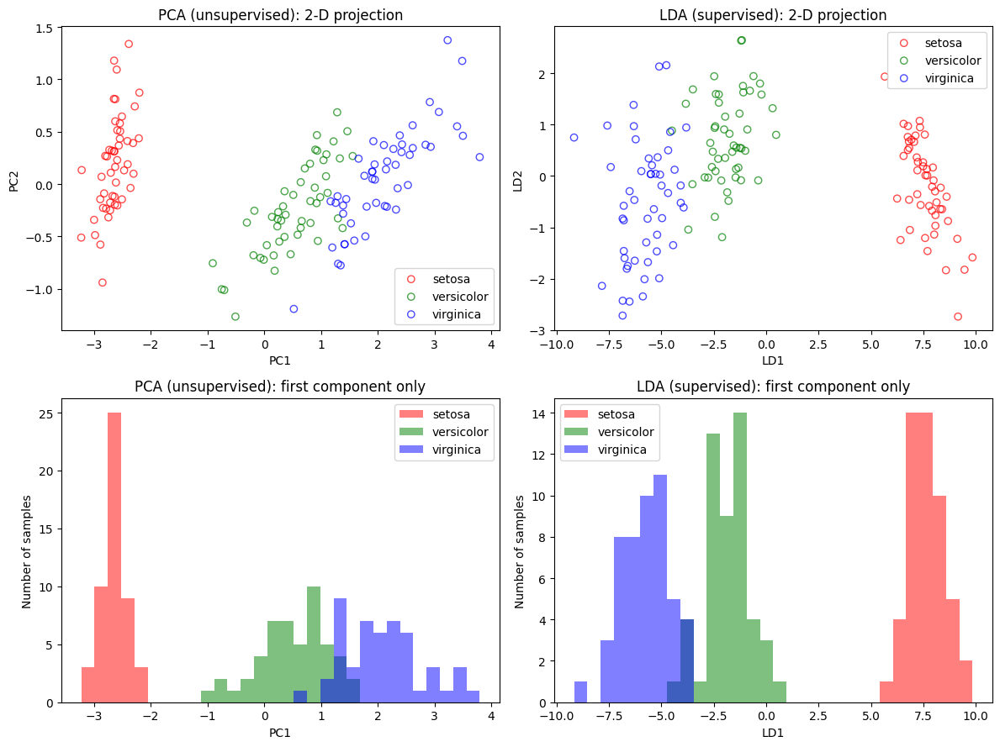

**座標軸**
- **左上**：X 軸 = PC1（第一主成分），Y 軸 = PC2（第二主成分）。
  - 主成分是 4 個原始特徵的線性組合，單位仍是 cm。
  - 中心在 0，代表與資料平均值的距離。
- **右上**：X 軸 = LD1，Y 軸 = LD2（LDA 判別軸，無單位）。內容與圖 6-3 相同，放在這裡方便並排比較。
- **下排**：只取上排的第一個成分（PC1 或 LD1）畫成直方圖。
  - X 軸 = 第一個成分的數值。
  - Y 軸 = 落在該區間的樣本數。
  - 30 個 bin，三個品種共用相同的區間。
- 顏色：紅 = setosa、綠 = versicolor、藍 = virginica。

**PC1 的組成**

PC1 = 0.361 × 花萼長度 − 0.085 × 花萼寬度 + **0.857 × 花瓣長度** + 0.358 × 花瓣寬度

PC1 主要由花瓣長度構成，因為花瓣長度的數值範圍最大（1–6.9 cm），變異也最大。

**觀察與解釋**
- **兩者都能把 setosa 完全分開。** setosa 在 PC1 上位於約 −3 附近，與其他兩類有明顯空隙。原因是 PC1 主要反映花瓣長度，而 setosa 的花瓣特別小。
- **只看第一個成分時，LDA 明顯優於 PCA**（下排）：

  | | versicolor 與 virginica 的重疊範圍 | 落在重疊範圍內的樣本數 |
  |---|---|---|
  | PC1 | 0.52 ~ 1.56 | **39 筆** |
  | LD1 | −4.50 ~ −3.82 | **8 筆** |

  PCA 找的是「整體變異最大」的方向，這個方向剛好能分開 setosa，但不是區分 versicolor 與 virginica 的最佳方向；LDA 則直接以「分開類別」為目標選擇方向。
- **看兩個成分時，PCA 追上了。** 左上圖中，versicolor 與 virginica 的交界是一條斜線，需要 PC2 一起看才分得開。PC2 主要由花萼長度與寬度構成（權重 0.657、0.730），補足了 PC1 缺少的資訊。

### 圖 8-2　各成分的解釋變異比例

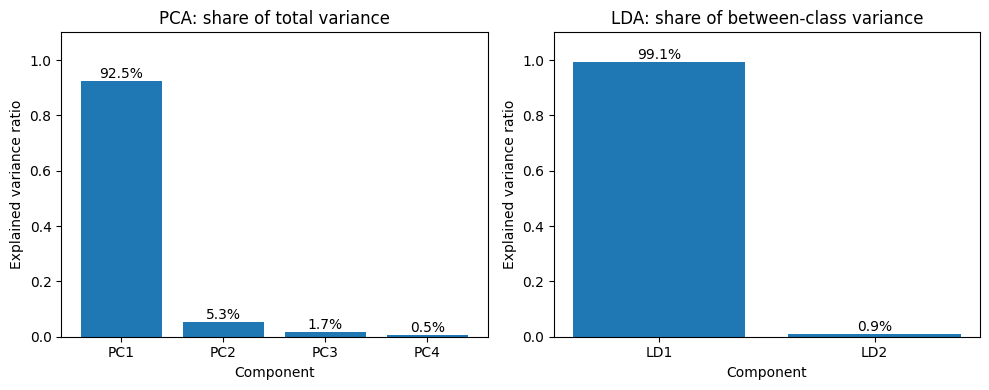

**座標軸**
- X 軸 = 成分（PCA 的 PC1–PC4，LDA 的 LD1–LD2）。
- Y 軸 = 解釋變異比例，兩邊的意義**不同**：
  - **PCA（左）**：該主成分佔**整體資料變異**的比例。
  - **LDA（右）**：該判別軸佔**類別間差異**的比例。

**觀察與解釋**
- **PCA**：PC1 佔 92.5%，PC1 + PC2 佔 97.8%。保留 2 個成分就幾乎沒有損失資訊，PC3、PC4 可以捨棄。
- **LDA**：LD1 佔 99.1%，LD2 只佔 0.9%。分開三個品種所需的資訊幾乎全部集中在 LD1。
- **兩邊的百分比不能直接比較。** PCA 的 92.5% 是指保留了多少「資料的樣貌」，LDA 的 99.1% 是指保留了多少「類別間的差異」。PCA 的 PC1 保留了大部分變異，卻不一定保留了分類需要的資訊，下表的 1 維結果就是例子。

### 投影後的 KNN 分類準確率

用 KNN（k = 5）在投影後的資料上分類，以重複 10-fold 交叉驗證（10 折 × 10 次）評估。
投影放在 pipeline 中，只用每一折的訓練資料擬合，避免測試資料洩漏。

| 輸入資料 | 驗證準確率 |
|---|---|
| PCA 1 維 | 91.6% ± 5.5% |
| **LDA 1 維** | **97.5% ± 3.9%** |
| PCA 2 維 | 96.8% ± 4.6% |
| LDA 2 維 | 96.4% ± 4.3% |
| 原始 4 維 | 96.4% ± 4.6% |

- **1 維時 LDA 比 PCA 高約 6%**，與圖 8-1 下排的重疊程度一致。
- **只用 LDA 1 維，就比用原始 4 維還好。** LDA 把 4 個特徵壓縮成 1 個最有鑑別力的數值，去掉了與分類無關的變異。
- **LDA 2 維反而比 1 維略低。** LDA 會把每個判別軸縮放成類內變異數為 1，所以幾乎不含分類資訊的 LD2，在 KNN 的距離計算中和 LD1 有一樣的份量，等於加入雜訊。這說明成分不是越多越好。
- **PCA 2 維與原始 4 維相當。** 這符合圖 8-2：PC1 + PC2 已保留 97.8% 的變異。
- 各結果的差距多在 1 個標準差以內，只有「PCA 1 維」明顯較低。

### 小結

在 Iris 上，**要降到 1 維時應選 LDA**；降到 2 維時兩者差不多。PCA 不需要標籤，適合沒有標籤或只想壓縮資料時使用；有標籤且目標是分類時，LDA 能用更少的維度保留更多鑑別資訊。

---

## 9. 決策邊界比較

程式：`05_model_evaluation/03_decision_boundaries.py`

決策邊界是模型在特徵空間中劃分「判定為哪一類」的界線。為了能畫在平面上，這一節只使用鑑別力最高的兩個特徵：**花瓣長度與花瓣寬度**。圖中文字與程式輸出皆為中文。

### 圖 9-1　KNN、LDA、K-Means 的決策邊界

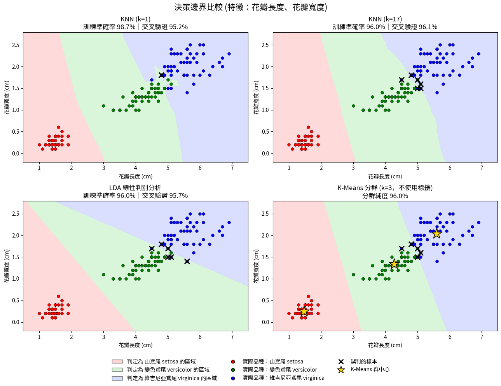

**座標軸**
- 四張子圖的 X 軸 = 花瓣長度 (cm)，Y 軸 = 花瓣寬度 (cm)。
- **底色**：模型對平面上每一點判定的品種。
  - 淺紅 = setosa、淺綠 = versicolor、淺藍 = virginica。
  - 不同底色的交界就是決策邊界。
- **圓點**：150 筆樣本，顏色為實際品種。
- **黑色 X**：模型判錯的樣本。
- **金色星號**（只在 K-Means）：3 個群中心。
- 子圖標題中，「訓練準確率」是用全部資料訓練後，再對同一批資料預測的準確率；「交叉驗證」是 10 折 × 10 次的平均驗證準確率。

**各模型結果**

| 模型 | 邊界形狀 | 訓練準確率 | 交叉驗證準確率 | 誤判筆數 |
|---|---|---|---|---|
| KNN (k = 1) | 曲折、有突出的小區塊 | 98.7% | 95.2% ± 5.2% | 2 |
| KNN (k = 17) | 平滑的曲線 | 96.0% | **96.1% ± 4.5%** | 6 |
| LDA | 直線 | 96.0% | 95.7% ± 4.9% | 6 |
| K-Means (k = 3) | 直線（兩個群中心連線的垂直平分線） | 純度 96.0% | 不適用 | 6 |

**觀察與解釋**
- **KNN k = 1 的邊界最曲折，是過擬合的典型樣子。**
  - 在 versicolor 與 virginica 交界處（花瓣長 4.8–5.2 cm、寬 1.5–1.8 cm），綠色區域伸出一塊突出的小區塊。這是為了遷就個別訓練樣本而畫出的邊界。
  - 它在訓練資料上最準（98.7%），交叉驗證卻是四者中最低（95.2%），與圖 4-1 的過擬合結論一致。
- **KNN k = 17 的邊界平滑許多。** 每個點由 17 個鄰居投票決定，個別樣本的影響被平均掉。訓練準確率下降，但交叉驗證準確率反而最高。
- **LDA 的邊界是直線。**
  - LDA 假設各類別的共變異數相同，推導出來的邊界必定是線性的。
  - setosa 與 versicolor 之間的直線離資料很遠，因為兩類之間空隙很大，任何位於空隙中的直線都能完美分開。
  - versicolor 與 virginica 之間的斜線則剛好穿過重疊區。
- **K-Means 的邊界也是直線，但原理不同。**
  - K-Means 把每個點分給最近的群中心，所以兩群的邊界是兩個中心連線的垂直平分線。
  - 它完全沒有使用標籤，邊界卻與 LDA 幾乎同樣準確（純度 96%）。這是因為在花瓣特徵上，三個品種本來就各自聚成一團。
  - 比較第 7 節：用 4 個特徵時 K-Means 只有 89.3%，只用花瓣反而更好，因為花萼特徵的重疊會干擾距離計算。
- **有些錯誤任何模型都無法避免。**
  - 花瓣長度與寬度只量到 0.1 cm，150 筆中有 48 筆和其他樣本座標完全相同，所以圖上看起來點比較少，重疊的點互相遮住。
  - 例如 (4.8, 1.8) 這個位置同時有 1 筆 versicolor 和 2 筆 virginica。不論模型怎麼畫邊界，這個點只能判成一類，必定會錯 1–2 筆，所以 k = 1 在這兩個特徵上的訓練準確率也只有 98.7%，達不到 100%。
- **錯誤集中在同一區域。** KNN k = 17、LDA、K-Means 有 3 筆誤判是共同的，全都位在 versicolor 與 virginica 的交界處。這與前面各節的結論一致：Iris 的分類難點只在這兩類的重疊區域。

---

## 10. 已知限制

- **第 6 節 LDA 的 98% 是在全部 150 筆資料上訓練並評估的。** 改用 10-fold 交叉驗證後（第 7 節）仍為 98%，表示 LDA 在 Iris 上沒有過擬合。
- **決策邊界圖只用 2 個特徵。** 第 9 節為了能畫在平面上只用花瓣長度與寬度，準確率與用 4 個特徵的結果（第 4、7 節）不能直接比較。
- **純度不是分群的標準評估指標。** 第 5-5 節的純度需要用到真實標籤，k 越大通常越高（極端情況下每點一群時為 100%），只適合在相同 k 之下比較不同特徵。

---

## 11. 執行環境

| 項目 | 本報告 | 早期版本報告 |
|---|---|---|
| 作業系統 | Linux | Windows 10 (10.0.19045) |
| 開發工具 | VS Code | PyCharm Community Edition 2023.1 |
| Python | 3.10.12 | 3.11 |
| 套件 | 見專案根目錄 `requirements.txt` (scikit-learn 1.7.2 等) | 未記錄 |

- 資料皆使用 sklearn 內建的 Iris 資料集。原始來源為 UCI Machine Learning Repository：<https://archive.ics.uci.edu/ml/datasets/iris>。
- 本報告已整合早期版本報告（`圖形辨識.docx` / `.pdf`）的內容：K-Means 原理、多個 k 的分群比較、SSE 與輪廓分析，並以固定亂數種子重新產生圖與數據。
- 早期報告認為「用花瓣特徵分群時極值誤判較嚴重，花萼較少」，但重新計算後結果相反：k = 3 時花瓣分錯 6 筆，花萼分錯 27 筆，見第 5-5 節。原文可從 git 歷史中取回。
